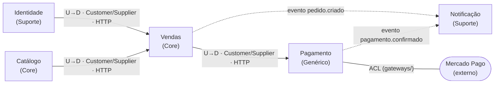

# Context Map, Domínios e Bounded Contexts

Estilo arquitetural: microsserviços reais, um por Bounded Context, cada um com banco próprio ([ADR-001](../documentacao-arquiteturial/ADRs/ADR-001-microsservicos-reais.md), [ADR-002](../documentacao-arquiteturial/ADRs/ADR-002-banco-por-servico.md)). Comunicação síncrona (HTTP) só no sentido Downstream → Upstream e assíncrona (eventos Redis Pub/Sub) para avisar quem reage ([ADR-003](../documentacao-arquiteturial/ADRs/ADR-003-comunicacao-sincrona-assincrona.md), [ADR-008](../documentacao-arquiteturial/ADRs/ADR-008-contrato-eventos-assincronos.md)).

## Domínio e Subdomínios

**Domínio:** e-commerce de celulares (venda online de produtos eletrônicos).

| Subdomínio | Tipo | Bounded Context | Justificativa |
|---|---|---|---|
| Venda e pedidos | **Core** | Vendas | É o que dá valor ao negócio: carrinho, regras de pedido, status e consistência do valor total. Recebe o maior investimento de modelagem (DDD tático). |
| Gestão de catálogo e estoque | **Core** | Catálogo | A vitrine e o controle de estoque (reserva e devolução por pedido) sustentam a venda e a diferenciam de uma loja que vende o que não tem. |
| Identidade e acesso | **Suporte** | Identidade | Necessário, mas não diferencia a loja. Tem regras próprias (cargos e permissões embutidos no JWT) que justificam código próprio. |
| Notificações | **Suporte** | Notificação | Apoia a experiência (e-mail de pedido criado e pago, formulário de contato), sem regra de negócio central. Reage a eventos. |
| Processamento de pagamento | **Genérico** | Pagamento | Problema resolvido da mesma forma em qualquer loja: a cobrança é delegada ao Mercado Pago. O serviço só integra e guarda o status. |

## Bounded Contexts (= os 5 microsserviços)

| Bounded Context | Responsabilidade | Relação com outros contextos |
|---|---|---|
| **Identidade** | Cadastro e autenticação de usuários, endereços, cargos e permissões | Upstream de Vendas (HTTP) |
| **Catálogo** | Produtos, categorias, marcas, busca, estoque e reservas | Upstream de Vendas (HTTP) |
| **Vendas** | Carrinho, criação e acompanhamento de pedidos | Downstream de Identidade e Catálogo (HTTP); Upstream de Pagamento (HTTP) e de Notificação (evento `pedido.criado`) |
| **Pagamento** | Cobrança e status de pagamento | Downstream de Vendas (HTTP: consulta o pedido e o marca como PAGO); Upstream de Notificação (evento `pagamento.confirmado`) |
| **Notificação** | E-mails transacionais e formulário de contato | Downstream de Vendas e Pagamento (somente eventos) |

## Context Map

Legenda: **U→D** = do Upstream (fornecedor) para o Downstream (cliente). Linha cheia = chamada HTTP; linha tracejada = evento assíncrono (Redis Pub/Sub).

### Padrões de relação

- **Customer/Supplier (Vendas ← Identidade, Catálogo; Pagamento ← Vendas):** o cliente depende do fornecedor, nunca o contrário. O Downstream chama o Upstream por HTTP, com timeout, retry e circuit breaker.
- **Published Language (eventos):** Vendas e Pagamento publicam eventos num contrato versionado e comum (envelope com `id`, `tipo`, `versao`, `origem`, `ocorridoEm`, `dados`, ADR-008). A Notificação só se adapta ao contrato; quem publica não sabe quem escuta.
- **Anticorruption Layer (Pagamento ↔ Mercado Pago):** a pasta `gateways/` isola o modelo do Mercado Pago atrás de uma interface própria (`Cobranca`, `PagamentoExterno`); o gateway simulado implementa a mesma interface. O resto do serviço não conhece o formato do Mercado Pago.

---

## Contexto detalhado: Vendas

Escolhido para detalhar por ser o contexto mais rico em regras de negócio do sistema.

### Aggregates

**1. `Pedido` (Aggregate Root)**
- **Invariantes:**
  - só nasce de um carrinho com pelo menos 1 item;
  - `valor_total` é calculado pelo serviço a partir dos itens (em centavos, para evitar erro de arredondamento) mais o frete, hoje fixo em 0;
  - o `status` só muda por transições válidas: `AGUARDANDO_PAGAMENTO → PAGO | CANCELADO`, `PAGO → ENVIADO | CANCELADO`, `ENVIADO → ENTREGUE`; `ENTREGUE` e `CANCELADO` são finais;
  - a troca de status é condicional ao status lido, então uma corrida (ex.: pagamento × expiração) tem um só vencedor.
- **Visibilidade:** o pedido é gravado como invisível (`ativo = false`) com itens, endereço e dados do cliente, e só passa a visível depois que o estoque foi reservado no Catálogo. Se a reserva falhar, o pedido é descartado.
- Toda alteração (gravar itens, mudar status) passa pelo agregado, por meio do `pedidoRepository` (um repository por agregado, [ADR-015](../documentacao-arquiteturial/ADRs/ADR-015-camada-repository.md)).

**2. `Carrinho` (Aggregate Root)**
- Contém `ItemCarrinho`. Cada usuário tem um carrinho ativo por vez.
- Ao criar o pedido o carrinho é encerrado (`ativo = false`), na mesma transação em que o pedido se torna visível: ou os dois acontecem, ou nenhum.

### Entities
- **`ItemPedido`** (dentro de `Pedido`) — identidade própria só dentro do agregado (`id_item`). Guarda `id_produto` apenas como referência ao Catálogo (sem chave estrangeira entre serviços) e o snapshot de `nome_produto`, `quantidade` e `preco_unitario`.
- **`ItemCarrinho`** (dentro de `Carrinho`) — item e quantidade escolhidos pelo cliente antes de fechar o pedido.

### Value Objects
- **`EnderecoEntrega`** (tabela `endereco_pedido`) — definido inteiramente pelos seus atributos (endereço, número, complemento, bairro, cidade, estado, CEP). Tem chave primária só por exigência da tabela, não por identidade de domínio. Imutável: é gravado na criação do pedido e nunca atualizado (só removido junto com um pedido descartado).
- **`DadosCliente`** (tabela `usuario_pedido`) — snapshot imutável de nome, e-mail, CPF e telefone do cliente no momento da compra. Guarda `id_usuario` só como referência a Identidade.

### Eventos de domínio publicados
- `pedido.criado` — quando o pedido se torna visível (Vendas → Notificação).
- `pagamento.confirmado` — quando o pagamento é confirmado (Pagamento → Notificação).

### Por que snapshot e não referência viva?
Porque `Pedido` pertence ao Bounded Context de Vendas e não deve depender do estado atual de `Usuario` (Identidade) ou `Produto` (Catálogo) para manter sua consistência histórica. Se o cliente mudar de nome ou o produto for descontinuado, o pedido já feito continua íntegro.
