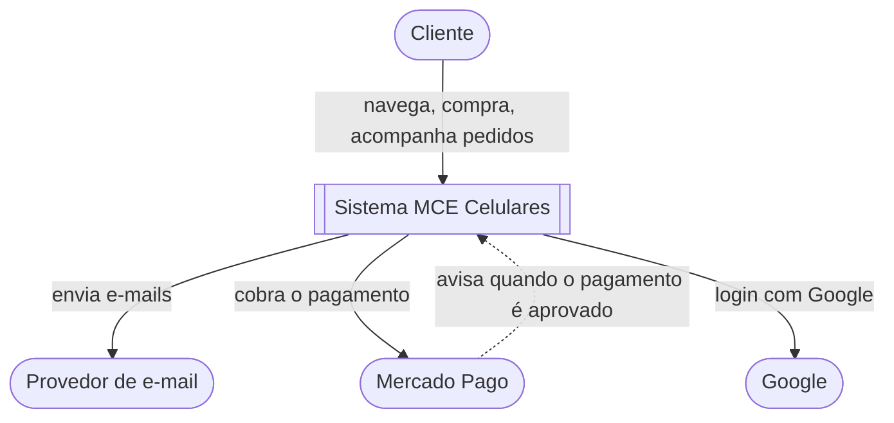
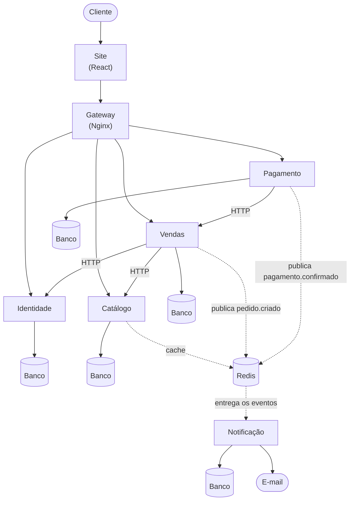

# Arquitetura (C4)

O sistema é uma loja online de celulares e eletrônicos. Ele é dividido em **5 microsserviços**, cada um com o seu próprio banco de dados.

## Nível 1: Contexto (quem usa o sistema e com quem ele conversa)

| Quem | Papel |
|---|---|
| Cliente | Usa o site para comprar |
| Provedor de e-mail | Entrega os e-mails de pedido e pagamento |
| Mercado Pago | Processa o pagamento |
| Google | Faz o login social |

## Nível 2: Containers (as peças que rodam)

Linha cheia: chamada HTTP direta. Linha tracejada: Redis (cache ou evento).

| Peça | O que faz |
|---|---|
| Site (React) | As telas da loja e o painel administrativo |
| Gateway (Nginx) | Única porta de entrada: recebe tudo e repassa ao serviço certo |
| Identidade | Cadastro, login, endereços, cargos e permissões |
| Catálogo | Produtos, categorias, marcas, estoque e imagens |
| Vendas | Carrinho e pedidos |
| Pagamento | Cobrança pelo Mercado Pago |
| Notificação | Envia os e-mails |
| Redis | Cache do catálogo e mensagens entre os serviços (Pub/Sub) |
| Bancos MySQL | Um por serviço; nenhum serviço lê o banco do outro |

## Como as peças conversam
- **Pelo gateway:** o site só chama o Nginx (`localhost:8080`). Ele repassa pelo prefixo da URL (`/vendas/...`, `/catalogo/...`).
- **Entre serviços, por HTTP:** quando precisam de uma resposta na hora. O Vendas pergunta preço e estoque ao Catálogo; o Pagamento consulta o pedido no Vendas.
- **Pelo Redis, por evento:** quando só precisam avisar. Vendas e Pagamento publicam, a Notificação reage e manda o e-mail. Quem publica não espera resposta.

As decisões por trás deste desenho estão em [decisoes.md](decisoes.md).
