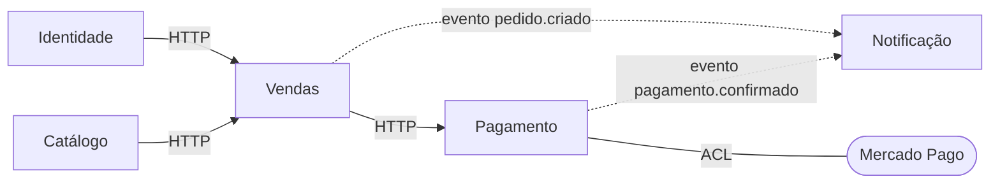

# DDD: domínios, contextos e agregados

## Domínio e subdomínios

O domínio é a loja online de celulares e eletrônicos. Cada subdomínio virou um serviço (um Bounded Context).

| Subdomínio | Tipo | Serviço | Por quê |
|---|---|---|---|
| Venda e pedidos | **Core** | Vendas | É o coração do negócio: as regras do pedido |
| Catálogo e estoque | **Core** | Catálogo | Sem estoque correto não há venda |
| Identidade e acesso | Suporte | Identidade | Necessário, mas não diferencia a loja |
| Notificações | Suporte | Notificação | Só avisa o cliente por e-mail |
| Pagamento | Genérico | Pagamento | Igual em qualquer loja: a cobrança fica com o Mercado Pago |

- **Core:** o que dá vantagem ao negócio e recebe mais esforço.
- **Suporte:** necessário, mas não é o diferencial.
- **Genérico:** problema comum, resolvido com um serviço pronto.

## Bounded Contexts

Um Bounded Context é uma fronteira dentro da qual cada termo tem um só significado. Aqui, cada um é um microsserviço com banco próprio.

| Contexto | Cuida de | Quem consome |
|---|---|---|
| Identidade | Usuários, login, endereços, cargos | Vendas |
| Catálogo | Produtos, categorias, marcas, estoque | Vendas |
| Vendas | Carrinho e pedidos | Pagamento e Notificação |
| Pagamento | Cobrança e status do pagamento | Notificação |
| Notificação | E-mails | ninguém (só recebe eventos) |

## Context Map

Seta cheia: chamada HTTP. Seta tracejada: evento no Redis. A seta aponta de quem fornece (upstream) para quem consome (downstream).

Padrões usados:
- **Customer/Supplier:** quem consome depende de quem fornece, nunca o contrário (Vendas depende de Identidade e Catálogo).
- **Published Language:** os eventos seguem um formato único e versionado, que a Notificação apenas lê.
- **Anticorruption Layer (ACL):** a pasta `gateways/` do Pagamento esconde o formato do Mercado Pago atrás de uma interface própria. Por isso o gateway simulado e o real são intercambiáveis.

## Detalhe do contexto Vendas

**Aggregates** (conjunto tratado como uma unidade, com uma raiz):
- **`Pedido`** (raiz). Regras:
  - só nasce de um carrinho com pelo menos 1 item;
  - o `valor_total` é calculado pelo serviço, nunca aceito do cliente;
  - o status só muda por transições válidas: `AGUARDANDO_PAGAMENTO → PAGO | CANCELADO`, `PAGO → ENVIADO | CANCELADO`, `ENVIADO → ENTREGUE`.
- **`Carrinho`** (raiz): um por usuário, encerrado na mesma transação em que o pedido é criado.

**Entities** (têm identidade): `ItemPedido` e `ItemCarrinho`.

**Value Objects** (definidos só pelos valores): `EnderecoEntrega` e `DadosCliente`.

**Eventos de domínio:** `pedido.criado` e `pagamento.confirmado`.

**Por que o pedido guarda uma cópia do endereço, do cliente e do produto?** Para o histórico não mudar se o cliente trocar de nome ou o produto sair do catálogo. Por isso também não há chave estrangeira entre serviços.
