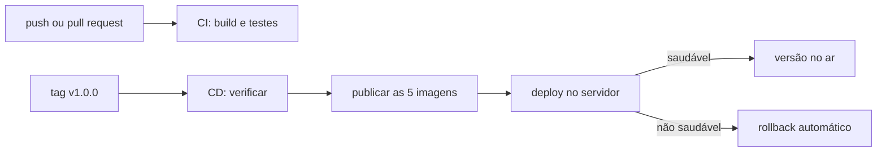

# Entrega contínua: pipeline, deploy e runbook

## Pipeline (CI/CD)

Os arquivos ficam em `.github/workflows/`: `ci.yml`, `cd.yml` e `rollback.yml`.

| Etapa | O que roda | Falha quando |
|---|---|---|
| **CI** (a cada push e pull request) | `tsc` e `jest` nos 5 serviços, contratos OpenAPI × rotas, regra de camadas, `nginx -t`, `docker compose config`, build das 5 imagens | erro de tipo, teste quebrado, rota sem contrato |
| **CD** (a cada tag `v*`) | repete `tsc`, constrói e publica as imagens no GitHub Container Registry, faz o deploy por SSH | qualquer passo falha; nada é publicado |
| **Rollback** (manual) | volta para uma versão anterior | a versão de destino não fica saudável |

O deploy só roda se a variável `DEPLOY_HOST` estiver configurada no GitHub; sem ela, só as imagens são publicadas.

## Estratégia de deploy: troca simples com verificação e rollback

1. `scripts/deploy.sh <tag>` baixa as imagens da tag e recria os serviços.
2. Confere a saúde de cada serviço pelo gateway.
3. **Saudável:** grava a tag atual (e guarda a anterior).
4. **Não saudável:** volta sozinho para a versão anterior e termina com erro, para o CD ficar vermelho.
5. Rollback manual: `./scripts/rollback.sh [tag]`, ou *Actions → Rollback → Run workflow*.

Para publicar uma versão: `git tag -a v1.0.0 -m "v1.0.0"` e `git push origin v1.0.0`.

**Por que não blue/green:** exigiria duas pilhas completas na mesma máquina. O rollback por tag volta em segundos e basta para este projeto.
**Limite:** o rollback troca a imagem, mas **não desfaz migrations**. Toda migration deve funcionar também com o código da versão anterior.

## Runbook de incidentes (o que fazer se o sistema cair)

**Primeiros 5 minutos:**
1. `docker compose ps -a`: o que está parado ou reiniciando?
2. `curl localhost:8080/<serviço>/health` (`identidade`, `catalogo`, `vendas`, `pagamento`, `notificacao`): `ok`, `degradado` (Redis fora) ou 503 (banco fora).
3. `docker compose logs --tail=100 <serviço>` para ver o erro.
4. Começou logo depois de um deploy? Faça o rollback primeiro e investigue depois.

| Sintoma | O que fazer |
|---|---|
| Nada responde (Docker ou servidor reiniciou) | `docker compose up -d`, esperar tudo ficar `healthy` e rodar `bash scripts/verificar-gateway.sh`. O Redis perde o cache e os logins (os usuários entram de novo) |
| 502 ou 504 em tudo | `docker compose up -d nginx` e `docker compose exec nginx nginx -t` |
| Um serviço reinicia em loop | Ver `docker compose logs <serviço>`. Causa comum: `.env` faltando ou senha do banco errada. Depois de mudar o `.env`: `docker compose up -d --force-recreate <serviço>` |
| Banco fora (503) | `docker compose up -d <serviço>_db`. **Nunca** rode `docker compose down -v`: apaga os dados |
| Redis fora (`degradado`) | A API segue sem cache, mas os e-mails não saem. `docker compose up -d redis` |
| Checkout com 503 | A mensagem diz qual serviço caiu. O circuit breaker volta sozinho a testar a cada 10 s |
| Pagamento aprovado, pedido ainda aguardando | Ver os logs do Pagamento. Sem webhook, `POST /pagamento/pagamentos/{id}/sincronizar` (o botão "Já paguei") confere no Mercado Pago |
| E-mails não saem | Conferir o SMTP. A tabela `notificacao_log` mostra os `FALHA`, e o reenvio automático tenta de novo a cada 60 s |
| Muitos erros 429 | É o limite por IP. Suba `RATE_LIMIT_*` no `.env` do serviço e recrie o container |

**Depois do incidente:** anote em 5 linhas o que quebrou, desde quando, como foi detectado, o que resolveu e o que muda para não se repetir.
