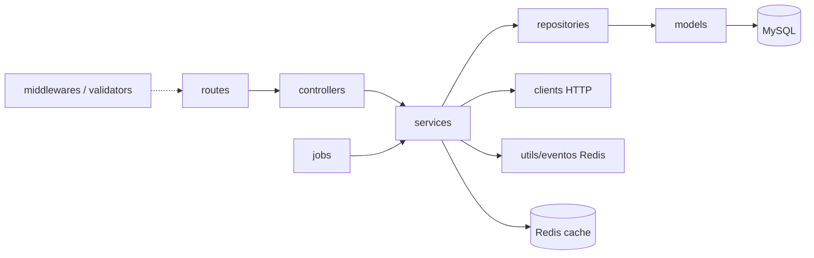

# Arquitetura em camadas de um serviço (C4 nível 3 — componentes)

Os 5 serviços (Identidade, Catálogo, Vendas, Pagamento, Notificação) seguem a mesma organização interna. Decisão em [ADR-015](ADRs/ADR-015-camada-repository.md); a regra é conferida no CI por `scripts/verificar-camadas.py`.

## Responsabilidade de cada camada

| Camada | Responsabilidade | Pode depender de |
|---|---|---|
| `routes` | Declara endpoints e liga middlewares (auth, permissão, validação) ao controller | controllers, middlewares, validators |
| `controllers` | Traduz HTTP em chamada de service e devolve a resposta (DTO) | services |
| `services` | Regras de negócio, decisão entre 404/409/seguir, abertura de transação | repositories, clients, utils (eventos, cache) |
| `repositories` | Único ponto de acesso ao banco: consultas, `UPDATE` condicional, travas, tradução de erros do banco | models |
| `models` | Mapeamento das tabelas no Sequelize | — |
| `clients` (Vendas, Pagamento) | Chamadas HTTP a outros serviços, com timeout, retry e circuit breaker | utils |
| `jobs` (Vendas, Notificação) | Tarefas agendadas (expirar pedidos, reenviar notificações) | services |
| `middlewares` / `validators` | Autenticação, permissão, log de requisição, erros, validação de entrada | — |

## Regras verificadas no CI

1. Só `repositories` importam `sequelize`, `config/database` e os `models` (fora `import type` e as constantes de status).
2. `controllers`, `routes` e `jobs` falam apenas com `services`, nunca direto com `repositories`.
3. `repositories` não importam `services`, `controllers`, `jobs`, `clients` nem `middlewares`.
4. `models` não importam `repositories` nem `services`.
5. Exceção: `controllers/healthController.ts` (só testa a conexão com o banco).

## Repositories por serviço (13)

| Serviço | Repositories |
|---|---|
| Identidade | `usuarioRepository`, `enderecoRepository`, `cargoRepository`, `permissaoRepository` |
| Catálogo | `produtoRepository`, `categoriaRepository`, `marcaRepository`, `reservaEstoqueRepository` |
| Vendas | `pedidoRepository`, `carrinhoRepository`, `painelRepository` |
| Pagamento | `pagamentoRepository` |
| Notificação | `notificacaoLogRepository` |

Cada serviço também tem `repositories/erros.ts` (erros de persistência, ex.: `RegistroDuplicadoError`) e `repositories/transacao.ts` (`comTransacao`), usados pelos services.

## Ao criar uma entidade nova

1. Crie o model e a migration.
2. Crie o repository dela em `src/repositories/`.
3. Use-o só a partir de um service.
4. Rode `python3 scripts/verificar-camadas.py` na raiz do repositório.
