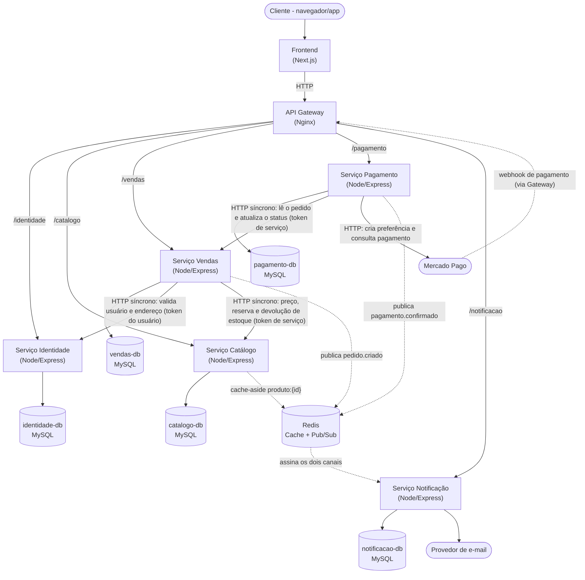

# C4 — Nível 2: Diagrama de Containers

Abre a caixa "Sistema MCEcelulares" e mostra as peças internas: os 5 microsserviços, o gateway, o Redis e os bancos de dados.

## Containers

| Container | Tecnologia | Responsabilidade |
|---|---|---|
| Frontend | Next.js | Telas do e-commerce (home, produtos, conta, carrinho, etc.) |
| API Gateway | Nginx | Ponto único de entrada, roteia por prefixo pra cada serviço |
| Serviço Identidade | Node/Express + Sequelize | Usuários, autenticação, endereços, cargos/permissões |
| Serviço Catálogo | Node/Express + Sequelize | Produtos, categorias, marcas, busca e filtros |
| Serviço Vendas | Node/Express + Sequelize | Carrinho, criação e acompanhamento de pedidos |
| Serviço Pagamento | Node/Express + Sequelize | Pagamento via Checkout Pro do Mercado Pago, webhook de confirmação e status de pagamento |
| Serviço Notificação | Node/Express + Sequelize | Envio de e-mails transacionais e formulário de contato |
| Redis | Redis | Cache-aside (produto), sessão renovável do Identidade (ADR-007) e mensageria Pub/Sub |
| Bancos MySQL | MySQL (x5) | Um banco isolado por serviço, sem FK entre eles; o schema é criado pelas migrations de cada serviço |

## Decisões que complementam este desenho
- **Vendas → Catálogo** (consulta de preço/estoque, reserva por pedido e devolução idempotente, com recuperação de órfãos): ADR-009.
- **Token de serviço** nas chamadas internas sem usuário: ADR-010.
- **Pagamento e Mercado Pago** (Checkout Pro, webhook, sincronização, confirmação idempotente): ADR-011.
- **Expiração de pedidos não pagos** (rotina do Vendas que devolve o estoque ao Catálogo): ADR-009, seção "Atualização".
- **Painel administrativo:** cada serviço expõe as próprias métricas (`dashboard:ver`): ADR-012.
- **Imagens de produto:** enviadas ao Catálogo, gravadas num volume e servidas por `/catalogo/imagens/`: ADR-013.
- **Cache-aside `user:{id}` no Vendas:** previsto na primeira versão deste diagrama e **descartado** (motivo no ADR-003, seção "Atualização"). A sessão renovável do Identidade (ADR-007) é o outro uso do Redis como armazenamento.
