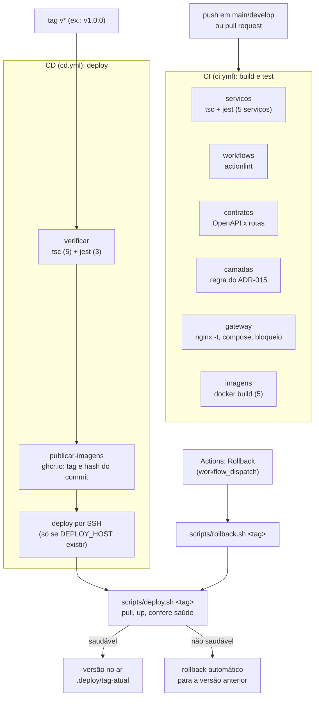

# Pipeline de CI/CD

Como o código vira uma versão no ar: **build e testes** a cada push, **publicação e deploy** a cada tag, **rollback** automático ou sob demanda. Os arquivos estão em `.github/workflows/` (`ci.yml`, `cd.yml`, `rollback.yml`) e `scripts/` (`deploy.sh`, `rollback.sh`). A estratégia (rollback por tag, sem blue/green) está no [ADR-014](ADRs/ADR-014-cd-com-rollback-por-tag.md).



## Jobs e o que bloqueia cada um

| Fluxo | Job | O que roda | Falha quando |
|---|---|---|---|
| CI | `servicos` (um por serviço) | `npm ci`, `tsc --noEmit`, migrations e seed (Identidade e Catálogo, num MySQL do próprio job) e `jest` | erro de tipo ou teste quebrado |
| CI | `workflows` | `actionlint` nos workflows (e nos scripts shell embutidos) | workflow inválido |
| CI | `contratos` | `scripts/verificar-contratos.py`: YAML válido e toda rota do código documentada | rota sem contrato |
| CI | `camadas` | `scripts/verificar-camadas.py`: só os repositories falam com o banco | violação da arquitetura em camadas |
| CI | `gateway` | `nginx -t`, bloqueio de `/catalogo/interno` sem diferenciar maiúsculas, `docker compose config` com e sem o profile `dev` | configuração inválida |
| CI | `imagens` (um por serviço) | `docker build` | imagem não compila no Linux (ex.: `package-lock` fora de sincronia) |
| CD | `verificar` (um por serviço) | `tsc --noEmit` nos 5; `jest` nos 3 que não usam banco | erro de tipo ou teste; **nada é publicado** |
| CD | `publicar-imagens` (um por serviço) | `docker build` e push para `ghcr.io/<dono>/mce-<serviço>:<tag>` e `:<hash curto do commit>` | falha de build ou de login no registro |
| CD | `deploy` | `deploy.sh <tag>` por SSH no servidor; **só roda se** a variável `DEPLOY_HOST` existir | saúde não confirmada (o próprio script já volta à versão anterior) |
| Rollback | `rollback` | `rollback.sh [tag]` por SSH, escolhida em *Actions → Rollback → Run workflow* | a versão de destino não fica saudável |

Gatilhos: o CI roda em `push` para `main` e `develop` e em todo `pull_request`; o CD roda quando se publica uma tag `v*`; o rollback é manual.

## Estratégia de deploy: troca simples com verificação e rollback

1. `deploy.sh <tag>` baixa as imagens da tag (`docker-compose.deploy.yml` troca o `build:` pela imagem versionada) e recria os 5 serviços (breve indisponibilidade durante a troca).
2. Confere a saúde pelo gateway: cada `/<serviço>/health` deve responder `"status":"ok"` (até `HEALTH_TENTATIVAS` tentativas, a cada `HEALTH_INTERVALO` segundos).
3. **Saudável:** grava `.deploy/tag-atual` (e guarda a anterior em `.deploy/tag-anterior`).
4. **Não saudável:** reaplica a versão anterior, confere a saúde de novo e termina com erro, para o job do CD ficar vermelho e alguém ser avisado.
5. `rollback.sh [tag]` faz o mesmo para uma tag escolhida; sem argumento, volta para `tag-anterior`.

Por que não blue/green: exigiria duas pilhas completas (inclusive bancos compatíveis) numa máquina só; o rollback por tag dá a volta em segundos com uma janela curta de indisponibilidade (ADR-014). **Limite principal:** o rollback de imagem não desfaz migrations, então toda migration deve ser compatível com a versão anterior do código.

O fluxo de deploy, rollback automático e rollback manual foi ensaiado com um registro local, incluindo uma versão com o Catálogo propositalmente quebrado: [demonstracao/deploy-e-rollback.md](../demonstracao/deploy-e-rollback.md).

## Configuração necessária no GitHub e no servidor

| Onde | Item | Para quê |
|---|---|---|
| Repositório (Variables) | `DEPLOY_HOST`, `DEPLOY_USER`, `DEPLOY_PATH` | destino do deploy por SSH; sem `DEPLOY_HOST` o job `deploy` é pulado e só as imagens são publicadas |
| Repositório (Secrets) | `DEPLOY_SSH_KEY` | chave privada para entrar no servidor |
| Automático | `GITHUB_TOKEN` com permissão `packages: write` | publicar no GitHub Container Registry |
| Servidor | Docker com Compose v2, o repositório clonado em `DEPLOY_PATH`, os `.env` de cada serviço preenchidos e `docker login ghcr.io` se as imagens forem privadas | `deploy.sh` roda `docker compose` ali |

## Como publicar uma versão

```bash
git tag -a v1.0.0 -m "v1.0.0"
git push origin v1.0.0       # dispara o CD: verificar, publicar imagens e, se configurado, deploy
```

Uma versão é imutável: para corrigir, publique outra tag. Para voltar atrás: *Actions → Rollback → Run workflow* (campo `tag`, ou vazio para a anterior), ou no servidor `REGISTRY_OWNER=<dono> ./scripts/rollback.sh [tag]`. O que fazer quando o deploy dá errado: [runbook](../operacao/runbook-incidentes.md), seção 3.9.

## O que foi verificado e o que não foi
- **Verificado localmente:** sintaxe e boas práticas dos 3 workflows (`actionlint`, sem erros); cada passo do CI que não depende do GitHub (`tsc`, testes, `nginx -t`, `docker compose config`, build das imagens); e a lógica do `deploy.sh` e do `rollback.sh`, com um registro local.
- **Não verificado aqui:** a execução real dos workflows no GitHub (publicação no GHCR, SSH no servidor). Roteiro de conferência: na aba *Actions* do repositório, confirme que o CI está verde em `main`; publique uma tag de teste (ex.: `v0.0.1`) e confirme que `verificar` e `publicar-imagens` passam e que os pacotes `mce-*-service` aparecem em *Packages*; só então configure as variáveis de deploy.
